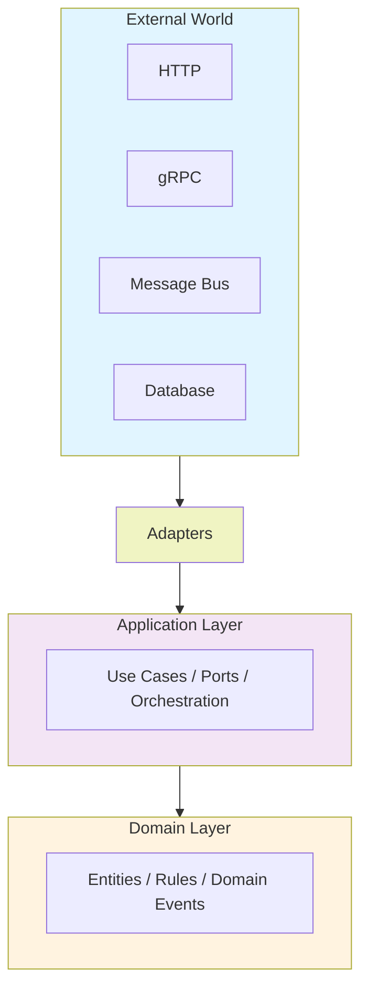
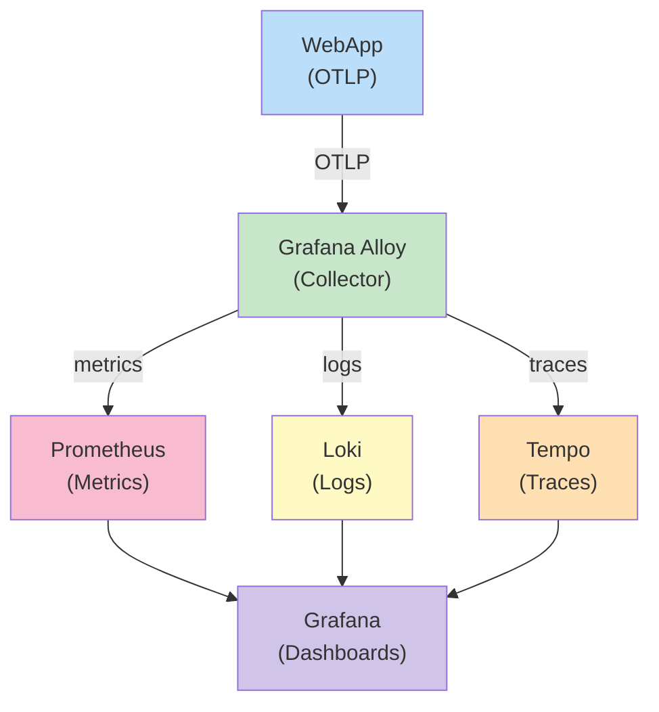

# 🏗️ Hexagonal Architecture Solution Template

A production-ready .NET template for building applications following [Hexagonal Architecture](https://alistair.cockburn.us/hexagonal-architecture/) (also known as Ports and Adapters). It ships with Domain-Driven Design (DDD) patterns, CQRS-style use cases, full observability, and a complete multi-layer testing strategy out of the box.

---

## 📑 Table of Contents

1. [Project Overview](#-project-overview)
2. [Project Structure](#-project-structure)
3. [Getting Started](#-getting-started)
4. [Running the Application](#-running-the-application)
5. [Testing Strategy](#-testing-strategy)
6. [Development Workflow](#-development-workflow)
7. [AI Agent Skills](#-ai-agent-skills)
8. [Helper Commands](#-helper-commands)
9. [Docker Setup](#-docker-setup)
10. [Monitoring & Telemetry](#-monitoring--telemetry)
11. [Contributing](#-contributing)

---

## 🌐 Project Overview

### What is Hexagonal Architecture?

Hexagonal Architecture isolates the core business logic from external concerns (databases, HTTP, messaging, caches) by defining explicit **ports** (interfaces) and **adapters** (implementations).



### Key Design Decisions

| Concern | Approach |
|---|---|
| Business rules | Encapsulated in `Domain` aggregates and entities |
| Orchestration | Single-responsibility `UseCase` classes in `Application` |
| Persistence | Repository pattern with EF Core (PostgreSQL) |
| Caching | Hybrid cache (Redis + in-memory) via `IHybridCacheService` |
| Messaging | RabbitMQ producers/consumers via MassTransit |
| API surface | ASP.NET Minimal API (REST) + gRPC |
| Observability | OpenTelemetry → Grafana / Loki / Tempo / Prometheus |
| Validation | FluentValidation, validated at the application boundary |

---

## 📁 Project Structure

```
.
├── src/
│   ├── Domain/                 # Core business logic – no external dependencies
│   ├── Application/            # Use cases, ports (interfaces), DTOs
│   ├── Infrastructure/         # Adapters: EF Core, Redis, RabbitMQ, OpenTelemetry
│   └── WebApp/                 # Entry point: Minimal API + gRPC
├── tests/
│   ├── CommonTests/            # Shared test utilities and base fixtures
│   ├── UnitTests/              # Isolated unit + architecture tests
│   ├── IntegrationTests/       # End-to-end slice tests with real infra
│   └── LoadTests/              # k6 performance scripts
└── scripts/
    └── grafana/                # Alloy, Loki, Prometheus, Tempo configs
```

### `src/Domain/`

The innermost layer. Has **zero dependencies** on any other project or NuGet infrastructure package.

```
Domain/
├── Common/
│   ├── DomainEntity.cs         # Base class for all domain entities (Id, timestamps)
│   ├── Result.cs               # Railway-oriented Result<T> type for error handling
│   ├── DefaultConfigurations.cs
│   ├── Enums/                  # Domain-scoped enumerations
│   ├── Exceptions/             # Domain-specific exceptions
│   └── Extensions/             # Pure domain extension methods
├── Orders/                     # Orders aggregate (entity, value objects, domain events)
└── Notifications/              # Notifications aggregate
```

> **Design note:** All business invariants are enforced inside domain entities and aggregates — never in services or controllers.

### `src/Application/`

Orchestrates domain objects and coordinates infrastructure through **ports (interfaces)**. Each use case lives in its own file and does exactly one thing.

```
Application/
├── Common/
│   ├── UseCases/               # BaseUseCase<TRequest, TResponse> base class
│   ├── Repositories/           # IBaseRepository<T> port interface
│   ├── Services/               # IHybridCacheService, IProduceService ports
│   ├── Requests/               # Shared request base types
│   ├── Messages/               # Integration message contracts (RabbitMQ)
│   └── Helpers/                # Mapping helpers, extension methods
├── Orders/
│   ├── CreateOrderUseCase.cs
│   ├── GetOrderUseCase.cs
│   ├── GetAllOrdersUseCase.cs
│   └── OrderDto.cs
└── Notifications/
    ├── CreateNotificationUseCase.cs
    ├── GetNotificationUseCase.cs
    ├── GetAllNotificationsUseCase.cs
    └── NotificationDto.cs
```

> **Design note:** Use cases accept a `Request` record and return a `Result<Response>`. They validate input via FluentValidation, call the domain, persist through the repository port, and optionally publish messages.

### `src/Infrastructure/`

Contains all **adapter implementations**. Depends on Application (for port interfaces) and Domain.

```
Infrastructure/
├── Data/
│   ├── MyDbContext.cs          # EF Core DbContext
│   ├── Migrations/             # EF Core migrations
│   ├── Mapping/                # Fluent API entity configurations
│   └── Repositories/           # IBaseRepository<T> implementations
├── Cache/                      # IHybridCacheService implementation (Redis + IMemoryCache)
├── Messaging/
│   ├── Producers/              # RabbitMQ message publishers (MassTransit)
│   └── Consumers/              # RabbitMQ message consumers (MassTransit)
└── OpenTelemetry/              # Tracing, metrics, logging wiring (OTLP exporter)
```

### `src/WebApp/`

The outermost adapter layer. Composes everything together and exposes the API.

```
WebApp/
├── Program.cs                  # DI registration & middleware pipeline
├── Endpoints/
│   └── OrderEndpoints.cs       # Minimal API route definitions
├── GrpcServices/               # gRPC service implementations
├── Protos/                     # .proto definition files
├── Middlewares/                # Custom middleware (error handling, correlation IDs, etc.)
└── Extensions/                 # WebApplication builder helpers
```

---

## 🚀 Getting Started

### Prerequisites

| Tool | Minimum Version | Notes |
|---|---|---|
| [.NET SDK](https://dotnet.microsoft.com/download) | 9.0 | `dotnet --version` |
| [Docker Desktop](https://www.docker.com/products/docker-desktop) | 4.x | For all backing services |
| [EF Core CLI](https://learn.microsoft.com/en-us/ef/core/cli/dotnet) | 9.0 | `dotnet tool install --global dotnet-ef` |
| [k6](https://k6.io/docs/get-started/installation/) | ≥ 0.50 | For load tests only |
| [Stryker.NET](https://stryker-mutator.io/docs/stryker-net/getting-started/) | latest | `dotnet tool install --global dotnet-stryker` |

### Installation

```bash
# 1. Restore NuGet packages
dotnet restore

# 2. Start backing services (PostgreSQL, Redis, RabbitMQ)
docker compose -f docker-compose-local.yml up -d

# 3. Run the application
dotnet run --project src/WebApp
```

> ⚠️ **Note:** `docker-compose-local.yml` also starts **pgAdmin** on port `5050` (credentials: `admin@admin.com` / `admin`). The `db-migrate` container automatically applies all pending EF Core migrations and seeds on first start.

---

## ▶️ Running the Application

```bash
dotnet run --project src/WebApp
```

By default the app listens on:
- **REST API:** `https://localhost:7000` (check `Properties/launchSettings.json`)
- **gRPC:** configured in `WebApp/GrpcServices/`
- **Health check:** `/health`
- **Swagger / OpenAPI:** `/swagger`

You can also use the included `.http` file for quick manual testing:

```
src/WebApp/WebApp.http
```

---

## 🧪 Testing Strategy

This template enforces a multi-layer testing strategy. See [TEST_STRUCTURE_GUIDE.md](TEST_STRUCTURE_GUIDE.md) for detailed patterns and conventions.

### Test Projects

| Project | Purpose | Runner |
|---|---|---|
| `CommonTests` | Shared fixtures, `BaseFixture`, `BaseApplicationFixture<T>` | — (library) |
| `UnitTests` | Domain logic, use case orchestration, architecture rules | `dotnet test` |
| `IntegrationTests` | Full HTTP/gRPC slice tests against a real DB | `dotnet test` |
| `LoadTests` | Performance and throughput benchmarks | `k6` |

### Unit Tests (`tests/UnitTests/`)

```
UnitTests/
├── Domain/                     # Entity invariants, Result type, value objects
├── Application/
│   ├── Orders/                 # CreateOrderUseCaseTests, GetOrderUseCaseTests, …
│   └── Notifications/          # CreateNotificationUseCaseTests, …
└── Architecture/               # ArchUnit-style dependency direction rules
```

**Naming convention:** `GivenContext_WhenCondition_ThenExpectedResult`

```csharp
[Fact(DisplayName = nameof(GivenAValidRequestThenPass))]
public async Task GivenAValidRequestThenPass() { ... }

[Fact(DisplayName = nameof(GivenAValidRequestWhenOrderNotFoundThenFails))]
public async Task GivenAValidRequestWhenOrderNotFoundThenFails() { ... }
```

**Run unit tests:**
```bash
dotnet test tests/UnitTests
```

### Integration Tests (`tests/IntegrationTests/`)

Spin up a real WebApp using `WebApplicationFactory<Program>` against a PostgreSQL test database.

```bash
dotnet test tests/IntegrationTests
```

### Load Tests (`tests/LoadTests/`)

Uses [k6](https://k6.io) to simulate concurrent traffic against the running application.

```bash
# REST API load test
k6 run tests/LoadTests/scriptHttp.js --summary-mode=full

# gRPC load test
k6 run tests/LoadTests/scriptGrpc.js --summary-mode=full

# Start full monitoring stack first for metrics in Grafana
docker compose up -d
```

### Mutation Tests (Stryker.NET)

Mutation testing validates test suite quality by introducing code faults and checking that tests catch them. Thresholds: **high ≥ 90%, low ≥ 80%, break < 50%**.

```bash
cd tests/UnitTests

# Mutate Application layer
dotnet stryker --config-file stryker-config-application.json

# Mutate Domain layer
dotnet stryker --config-file stryker-config-domain.json
```

HTML reports are written to `tests/UnitTests/StrykerOutput/`.

### Run All Tests (except load tests)

```bash
dotnet test
```

---

## 🔧 Development Workflow

### Adding a New Feature (e.g., `Products`)

Follow the dependency direction: **Domain → Application → Infrastructure → WebApp**.

**1. Domain — define the entity**
```
src/Domain/Products/Product.cs          # Entity with invariants
```

**2. Application — add use case(s)**
```
src/Application/Products/CreateProductUseCase.cs
src/Application/Products/GetProductUseCase.cs
src/Application/Products/ProductDto.cs
```

**3. Infrastructure — add persistence**
```
src/Infrastructure/Data/Mapping/ProductConfiguration.cs   # EF Core config
```
Then create and apply a migration:
```bash
dotnet ef migrations add AddProduct --project src/Infrastructure --startup-project src/Infrastructure --output-dir Data/Migrations

# Apply locally without Docker:
dotnet ef database update -p src/Infrastructure/ \
  --connection "Host=127.0.0.1;Port=5432;Database=OrderDb;Username=postgres;Password=cY5VvZkkh4AzES"
```

**4. WebApp — expose the endpoint**
```
src/WebApp/Endpoints/ProductEndpoints.cs
```
Register routes in `EndpointExtensions.cs`.

**5. Tests — cover every layer**
```
tests/UnitTests/Domain/Products/
tests/UnitTests/Application/Products/
tests/IntegrationTests/WebApp/Products/
```

> ✅ **Tip:** Architecture tests in `tests/UnitTests/Architecture/` will automatically enforce that your new code respects the dependency rules.

---

## 🤖 AI Agent Skills

This template includes prebuilt Copilot skills to standardize generation and reduce implementation drift across contributors.

### Skills location

All skills are stored under:

```
.github/skills/
```

Each skill contains:
- `SKILL.md` — behavior, activation criteria, and conventions
- `references/` — local templates and snippets used by the skill (self-contained)

### Available skills

| Skill | Purpose |
|---|---|
| `entity-generator` | Generate domain entities with DDD patterns, tests, and persistence guidance |
| `use-case-generator` | Generate Application use cases (`BaseInOutUseCase`, `BaseInUseCase`, `BaseOutUseCase`) with validators, notification patterns, and xUnit unit tests with fixtures, mocks, and logging/repository verification |
| `endpoints-generator` | Generate ASP.NET Minimal API endpoints with cache, correlation ID, status code conventions, and mandatory `src/WebApp/WebApp.http` samples for local endpoint testing |
| `consumers-generator` | Generate RabbitMQ consumers and message contracts using `BaseConsumer<TMessage, TConsumer>` patterns |
| `ef-mapper` | Generate/update EF Core mapping classes with precision, enum conversion, relationships, and migration guidance |
| `integration-tests-generator` | Generate integration tests for HTTP, gRPC, and messaging flows using `WebApplicationFactory` conventions |
| `load-tests-generator` | Generate k6 load test scripts for HTTP/gRPC with thresholds, metrics, and env-driven profiles |

### How to use

Ask Copilot with intent that matches the skill. Examples:

- "Create a new domain entity with tests for Product"
- "Generate a use case and validator for updating product prices"
- "Add minimal API endpoints for Products"
- "Create integration tests for the new endpoint"
- "Generate a k6 script for the products GET endpoint"

> ✅ **Best practice:** Keep skill templates and references in `./references` inside each skill folder. This prevents breakage if source files are moved or renamed.

> 🧪 **Endpoint skill rule:** Whenever `endpoints-generator` creates a new endpoint route, add/update the corresponding request sample in `src/WebApp/WebApp.http` so local manual tests stay in sync with the API contract.

---

## 🛠️ Helper Commands

### Database Migrations

```bash
# Apply pending migrations locally (without Docker)
dotnet ef database update -p src/Infrastructure/ \
  --connection "Host=127.0.0.1;Port=5432;Database=OrderDb;Username=postgres;Password=cY5VvZkkh4AzES"

# Create a new migration
dotnet ef migrations add <MigrationName> \
  --project src/Infrastructure \
  --startup-project src/Infrastructure \
  --output-dir Data/Migrations
```

> Migrations and seed data are applied automatically at startup by the `db-migrate` Docker service (`Dockerfile.migrate`). The manual command above is only needed for local development without Docker.

### Running the App

```bash
dotnet run --project src/WebApp

# Hot reload during development
dotnet watch run --project src/WebApp
```

### Running Tests

```bash
# All tests (excludes load tests)
dotnet test

# Unit tests only
dotnet test tests/UnitTests

# Integration tests only
dotnet test tests/IntegrationTests

# With coverage report
dotnet test --collect:"XPlat Code Coverage"
```

### Mutation Tests

```bash
cd tests/UnitTests
dotnet stryker --config-file stryker-config-application.json
dotnet stryker --config-file stryker-config-domain.json
```

### Load Tests

```bash
k6 run tests/LoadTests/scriptHttp.js --summary-mode=full
k6 run tests/LoadTests/scriptGrpc.js --summary-mode=full
```

---

## 🐳 Docker Setup

### `docker-compose-local.yml` — Development environment

Starts all backing services for local development:

| Service | Port(s) | Purpose |
|---|---|---|
| PostgreSQL 17 | `5432` | Primary database |
| db-migrate | — | Runs EF Core migrations and seeds on startup |
| pgAdmin | `5050` | Database GUI |
| Redis 8 | `6379` | Distributed cache |
| RabbitMQ | `5672` / `15672` | Message broker / Management UI |

```bash
docker compose -f docker-compose-local.yml up -d

# Tear down (keeps volumes)
docker compose -f docker-compose-local.yml down

# Tear down including volumes
docker compose -f docker-compose-local.yml down -v
```

> ⚠️ **Note:** On first start, `db-migrate` automatically applies all pending EF Core migrations (including seed data migrations) via `dotnet ef database update`.

### `docker-compose.yml` — Full stack (with observability)

Adds the complete monitoring stack on top of the local services:

| Service | Port | Purpose |
|---|---|---|
| Grafana | `3000` | Dashboards |
| Prometheus | `9090` | Metrics scraping |
| Loki | `3100` | Log aggregation |
| Tempo | `4317` | Distributed tracing (OTLP) |
| Grafana Alloy | — | Telemetry collector |

```bash
docker compose up -d
```

### `docker-compose-load-tests.yml` — Load test environment

Spins up a stable environment optimized for k6 load tests.

```bash
docker compose -f docker-compose-load-tests.yml up -d
k6 run tests/LoadTests/scriptHttp.js --summary-mode=full
```

### Build & run the application in Docker

```bash
docker build -t hexagonal-template .
docker run -p 8080:8080 hexagonal-template
```

---

## 📊 Monitoring & Telemetry

The template uses **OpenTelemetry** with OTLP exporters, collected and routed by **Grafana Alloy**.

### Stack



### Accessing the dashboards

Start the full stack first:

```bash
docker compose up -d
dotnet run --project src/WebApp
```

| Dashboard | URL | Credentials |
|---|---|---|
| Grafana | <http://localhost:3000> | `admin` / `admin` |
| Prometheus | <http://localhost:9090> | — |
| RabbitMQ | <http://localhost:15672> | `guest` / `guest` |
| pgAdmin | <http://localhost:5050> | `admin@admin.com` / `admin` |

### Configuration files

| File | Purpose |
|---|---|
| `scripts/grafana/config.alloy` | Grafana Alloy pipeline (scrape → export) |
| `scripts/grafana/datasources.yaml` | Pre-provisioned Grafana data sources |
| `scripts/grafana/prometheus.yml` | Prometheus scrape targets |
| `scripts/grafana/loki-config.yaml` | Loki storage configuration |
| `scripts/grafana/tempo.yaml` | Tempo trace storage configuration |

> ✅ **Tip:** Structured logs from the application include a `CorrelationId` that can be used to pivot from a log entry directly to the trace in Tempo's Explore view in Grafana.

---


### Guidelines

1. Follow the layer dependency rules enforced by the architecture tests.
2. Every new use case must have unit tests following the `GivenContext_WhenCondition_ThenExpectedResult` naming convention.
3. Run `dotnet test` and both Stryker configs before opening a pull request.
4. Keep domain entities free from infrastructure concerns — no EF Core attributes inside `Domain/`.

## 🧭 Development Patterns

Detailed patterns and examples for each layer. The short rules for AI agents are in [AGENTS.md](AGENTS.md).

### Domain entities

Entities extend `DomainEntity` (`Id`, `CreatedAt`, `UpdatedAt`, `DeletedAt`). Two patterns are used:

- **Pattern A, aggregate root:** a static `Create()` factory returns `Result<T>`. Business methods return `Result<Unit>`.
- **Pattern B, child entity or value object:** the constructor validates and throws `DomainException` on invalid input. No factory is needed.

```csharp
public sealed class Order : DomainEntity
{
    public string OrderNumber { get; private set; }
    public OrderStatus Status { get; private set; }
    public decimal TotalAmount { get; private set; }

    private Order() { }  // Required by EF Core

    public static Result<Order> Create(string orderNumber, decimal totalAmount)
    {
        if (string.IsNullOrWhiteSpace(orderNumber))
            return Result.Failure<Order>("Order number is required");
        if (totalAmount <= 0)
            return Result.Failure<Order>("Total amount must be positive");

        return Result.Success(new Order
        {
            OrderNumber = orderNumber,
            Status = OrderStatus.Pending,
            TotalAmount = totalAmount
        });
    }

    public Result<Unit> MarkAsShipped()
    {
        if (Status != OrderStatus.Pending)
            return Result.Failure<Unit>("Only pending orders can be shipped");
        Status = OrderStatus.Shipped;
        return Result.Success(Unit.Value);
    }
}
```

```csharp
public sealed class OrderItem : DomainEntity
{
    public OrderItem() { }  // Required by EF Core

    public OrderItem(string name, decimal price, int quantity)
    {
        if (string.IsNullOrWhiteSpace(name))
            throw new DomainException("Item name is required");
        if (price <= 0)
            throw new DomainException("Item price must be positive");

        Name = name;
        Price = price;
        Quantity = quantity;
    }

    public string Name { get; private set; }
    public decimal Price { get; private set; }
    public int Quantity { get; private set; }
}
```

### Use cases

| Base class | Use when |
|---|---|
| `BaseInOutUseCase<TRequest, TResponse>` | Create, Get, Update: returns data |
| `BaseInUseCase<TRequest>` | Delete or other side effects with no response payload |
| `BaseOutUseCase<TResponse>` | No input, returns data |

- Name by operation: `Create{Entity}UseCase`, `Get{Entity}UseCase`, `Update{Entity}UseCase`, `Delete{Entity}UseCase`, `GetAll{Entity}UseCase`.
- Requests inherit `BaseRequest`, which provides `CorrelationId`, `User`, and `TimezoneId`.
- Validators implement `AbstractValidator<TRequest>` in `{Operation}RequestValidator.cs`. DI discovers them and validation runs automatically.
- Messages are published with `CreateNotification()` or `IProduceService.ProduceAsync()`.

```csharp
public sealed record CreateOrderRequest(
    Guid CorrelationId,
    string Description,
    CreateOrderItemRequest[] Items,
    string CreatedBy = "",
    string TimezoneId = ""
) : BaseRequest(CorrelationId, CreatedBy, TimezoneId);

public sealed record CreateOrderItemRequest(string Name, string Description, decimal Value);

public sealed class CreateOrderUseCase : BaseInOutUseCase<CreateOrderRequest, OrderDto>
{
    private readonly IBaseRepository<Order> _repository;
    private readonly IProduceService _producer;
    private readonly ILogger<CreateOrderUseCase> _logger;

    public CreateOrderUseCase(
        IBaseRepository<Order> repository,
        IProduceService producer,
        ILogger<CreateOrderUseCase> logger
    ) : base(validator)
    {
        _repository = repository;
        _producer = producer;
        _logger = logger;
    }

    public override async Task<Result<OrderDto>> Execute(CreateOrderRequest request, CancellationToken cancellationToken)
    {
        var orderResult = Order.Create(request.OrderNumber, request.TotalAmount);
        if (orderResult.IsFailure)
            return Result.Failure<OrderDto>(orderResult.Error);

        var order = orderResult.Value;
        await _repository.AddAsync(order, cancellationToken);
        await _repository.SaveChangesAsync(cancellationToken);

        _logger.LogInformation("Order created: {OrderId}", order.Id);
        await _producer.ProduceAsync(new OrderCreatedEvent { OrderId = order.Id }, cancellationToken);

        return Result.Success(new OrderDto(order.Id, order.OrderNumber, order.TotalAmount));
    }
}
```

> The example above mirrors the template's original sample. Its request record does not declare `OrderNumber` or `TotalAmount`, so adapt it to your request shape when copying.

DTOs are immutable records used for application responses, for example `public record OrderDto(Guid Id, string OrderNumber, decimal TotalAmount);`. Never serialize entities directly.

### Full-text search (multiple records)

For use cases that return more than one record:

- **Request:** inherit `BaseFullTextSearchPaginatedRequest` (`Page`, `PageSize`, `SortBy`, `SortDescending`, `SearchValue`).
- **Response:** `BasePaginatedResponse<TDto>`.
- **Repository call:** `GetAllFullTextSearchPaginatedAsync<TEntity, TDto>`. Pass `nameof(Entity.Column)` as `searchQuery` and `request.SearchValue` as `searchValue`. The language defaults to `"english"` inside the repository; do not pass it from the request.
- **Index required:** a GIN tsvector index must exist on the searched columns. Without it, queries fail or fall back to a sequential scan.

```csharp
public sealed class GetAllOrdersUseCase : BaseInOutUseCase<BaseFullTextSearchPaginatedRequest, BasePaginatedResponse<OrderDto>>
{
    private readonly IBaseRepository<Order> _repository;

    public GetAllOrdersUseCase(IBaseRepository<Order> repository) : base(validator)
        => _repository = repository;

    public override async Task<Result<BasePaginatedResponse<OrderDto>>> Execute(
        BaseFullTextSearchPaginatedRequest request, CancellationToken cancellationToken)
    {
        var (items, total) = await _repository.GetAllFullTextSearchPaginatedAsync<Order, OrderDto>(
            request.CorrelationId,
            request.Page,
            request.PageSize,
            o => new() { Id = o.Id, Description = o.Description },
            cancellationToken,
            request.SortBy,
            request.SortDescending,
            nameof(Order.Description),
            request.SearchValue
        );

        return items.Any()
            ? Result.Success(new BasePaginatedResponse<OrderDto>(items, total, request.Page, request.PageSize))
            : Result.Failure<BasePaginatedResponse<OrderDto>>("No orders found.");
    }
}
```

### Persistence

- Repositories inherit `BaseRepository<T>`, which implements `IBaseRepository<T>` on EF Core `DbSet`s.
- The `IsDeleted` global query filter hides soft-deleted rows.
- One mapping per entity in `Data/Mapping/{Entity}Configuration.cs`, using the Fluent API for keys, columns, relationships, enums, precision, and defaults.
- Custom repository logic, when needed, goes in `Data/Repositories/{Entity}Repository.cs`.
- Entities used with `GetAllFullTextSearchPaginatedAsync` need a GIN tsvector index in their mapping. Create it through a migration before using the endpoint in any environment. When adding full-text search to an existing entity, use a dedicated migration (for example `Add{Entity}FullTextSearchSupport`) so the index is tracked apart from schema changes.

```csharp
public sealed class OrderConfiguration : IEntityTypeConfiguration<Order>
{
    public void Configure(EntityTypeBuilder<Order> builder)
    {
        builder.HasKey(x => x.Id);
        builder.Property(x => x.OrderNumber).IsRequired().HasMaxLength(50);
        builder.Property(x => x.TotalAmount).HasPrecision(18, 2);
        builder.Property(x => x.Status).HasConversion<string>();
        builder.HasQueryFilter(p => !p.IsDeleted);

        // Required for GetAllFullTextSearchPaginatedAsync (single column; use an anonymous type with several properties for multi-column)
        builder.HasIndex(p => new { p.Description })
            .HasMethod("GIN")
            .IsTsVectorExpressionIndex("english");
    }
}
```

### Messaging consumers

- Inherit `BaseConsumer<TMessage, TConsumer>` and implement `HandleUseCaseAsync(IServiceProvider, TMessage, CancellationToken)`.
- Place consumers in `Messaging/Consumers/`. They are registered automatically when they implement `IHostedService`.
- Deduplication: `CorrelationId` is the cache key in `IHybridCacheService`. Duplicate messages are skipped.
- Each message creates a telemetry span and updates error and duplicate counters.
- Queues: `{QueueName}` and `{QueueName}_deadLetter` are declared on startup. Unhandled exceptions are routed to the dead-letter queue.

Message contracts live in `src/Application/Common/Messages/` and extend `BaseMessage`:

```csharp
public abstract record BaseMessage(Guid CorrelationId, DateTime CreatedAt);

public sealed record CreateNotificationMessage(
    Guid CorrelationId,
    NotificationType NotificationType,
    NotificationStatus NotificationStatus,
    string? CreatedBy = null,
    object? Message = null
) : BaseMessage(CorrelationId, DateTime.UtcNow);
```

```csharp
internal sealed class CreateNotificationConsumer(
    ILogger<CreateNotificationConsumer> logger,
    IServiceScopeFactory serviceScopeFactory,
    IConfiguration configuration
) : BaseConsumer<CreateNotificationMessage, CreateNotificationConsumer>(
    logger,
    serviceScopeFactory,
    configuration,
    NotificationType.OrderCreated
)
{
    protected override async Task HandleUseCaseAsync(
        IServiceProvider serviceProvider,
        CreateNotificationMessage message,
        CancellationToken cancellationToken
    ) => await serviceProvider
        .GetRequiredService<IBaseInUseCase<CreateNotificationRequest>>()
        .HandleAsync(new(
            message.CorrelationId,
            message.NotificationType,
            message.NotificationStatus,
            message.CreatedBy,
            message.Message
        ), cancellationToken);
}
```

### Endpoints

- **File per resource:** `Endpoints/{Resource}Endpoints.cs`, a static `internal` class with an extension method such as `MapOrderEndpoints`.
- **Routing:** `MapGroup`, with use cases injected into handlers through `[FromServices]`.
- **Correlation:** read `[FromHeader] Guid correlationId` and tag the activity with `Activity.Current?.AddTag("correlation-id", correlationId)`.
- **Caching:** optional `[FromHeader] bool cacheEnabled = true` for hybrid caching.
- **Responses:** `BaseResponse<T>` for single items, `BasePaginatedResponse<T>` for lists.
- **Registration:** one line per group in `Endpoints/EndpointExtensions.cs`, for example `app.MapOrderEndpoints();`.
- **Samples:** add realistic requests to `src/WebApp/WebApp.http` for each new endpoint.

| Route | Success | Failure |
|---|---|---|
| `GET /{id}` | `200 OK` | `404 Not Found` |
| `POST /` | `201 Created` with `Location` | `400 Bad Request` |
| `PUT /{id}` | `200 OK` | `400 Bad Request` |
| `DELETE /{id}` | `200 OK` | `400 Bad Request` |
| `POST /paginated` | `200 OK` | `400 Bad Request` |
| `POST /full-text-search-paginated` | `200 OK` | `400 Bad Request` |

```csharp
public sealed class OrderEndpoints
{
    private const string BaseRoute = "/api/orders";

    public static void MapOrderEndpoints(this WebApplication app)
    {
        var group = app.MapGroup(BaseRoute)
            .WithName("Orders")
            .WithTags("Orders");

        group.MapGet("/", GetAll).WithName("GetAllOrders").WithOpenApi();
        group.MapGet("/{id}", GetById).WithName("GetOrderById").WithOpenApi();
        group.MapPost("/", Create).WithName("CreateOrder").WithOpenApi();
        group.MapPut("/{id}", Update).WithName("UpdateOrder").WithOpenApi();
        group.MapDelete("/{id}", Delete).WithName("DeleteOrder").WithOpenApi();
    }

    private static async Task<IResult> Create(
        [FromBody] CreateOrderRequest request,
        [FromHeader] Guid correlationId,
        CreateOrderUseCase useCase,
        CancellationToken cancellationToken
    )
    {
        var result = await useCase.Execute(request, cancellationToken);
        return result.IsFailure
            ? Results.BadRequest(result.Error)
            : Results.CreatedAtRoute("GetOrderById", new { id = result.Value.Id }, result.Value);
    }

    private static async Task<IResult> GetById(
        Guid id,
        [FromHeader] Guid correlationId,
        [FromHeader] bool cacheEnabled = true,
        GetOrderUseCase useCase,
        CancellationToken cancellationToken)
    {
        var result = await useCase.Execute(new GetOrderRequest(id), cancellationToken);
        return result.IsFailure
            ? Results.NotFound()
            : Results.Ok(result.Value);
    }

    // Other handlers omitted
}
```

### Dependency injection

- **Auto-discovery:** `Program.cs` registers use cases (classes inheriting a base use case), validators (`AbstractValidator<T>`), and consumers (`IHostedService` in `Messaging.Consumers`). No manual registration is needed.
- **Manual registration:** only for custom ports and adapters, for example `services.AddScoped<IMyService, MyService>();` in `InfrastructureDependencyInjection.cs`.
- **Adding a port and adapter:** define the interface in Application under `Common/Services/`, implement it in Infrastructure, and register it in `InfrastructureDependencyInjection.cs`.

Key locations:

- `src/Application/ApplicationDependencyInjection.cs`: use case and validator registration.
- `src/Infrastructure/InfrastructureDependencyInjection.cs`: repository, cache, and messaging registration.
- `src/Infrastructure/Data/MyDbContext.cs`: EF Core context.
- `src/Infrastructure/Cache/Services/HybridCacheService.cs`: Redis and in-memory hybrid cache.
- `src/Infrastructure/OpenTelemetry/`: tracing, metrics, and logging configuration.

### Testing patterns

**Naming:** `GivenContext_WhenCondition_ThenExpectedResult`.

**Unit test fixtures:** `BaseApplicationFixture<TRequest, TUseCase>` auto-mocks `IBaseRepository<T>`, `IProduceService`, `IHybridCacheService`, and a logger. Shared fixtures live in `tests/CommonTests/Fixtures/`.

```csharp
public class CreateOrderTestFixture : BaseHttpFixture
{
    public CreateOrderRequest SetValidRequest()
    {
        var items = AutoFixture.Build<CreateOrderItemRequest>()
            .With(i => i.Value, AutoFixture.Create<decimal>() + 1)
            .CreateMany(2)
            .ToArray();

        return AutoFixture.Build<CreateOrderRequest>()
            .With(r => r.Items, items)
            .With(r => r.TimezoneId, "UTC")
            .Create();
    }

    public CreateOrderRequest SetInvalidRequest() => AutoFixture
        .Build<CreateOrderRequest>()
        .With(r => r.Description, string.Empty)
        .With(r => r.TimezoneId, "UTC")
        .Create();
}
```

**HTTP integration tests:** run against `WebApplicationFactory<Program>` with a real PostgreSQL database, and clean up data between tests. Annotate with `[Collection("WebApplicationFactoryCollectionDefinition")]`, inherit `BaseHttpFixture`, and call `SetApiHelper` in the constructor. Deserialize responses as `BaseResponse<T>` and cover both success and failure.

```csharp
[Collection("WebApplicationFactoryCollectionDefinition")]
public sealed class CreateOrderTest : IClassFixture<CreateOrderTestFixture>
{
    private readonly CreateOrderTestFixture _fixture;

    public CreateOrderTest(CustomWebApplicationFactory<Program> factory, CreateOrderTestFixture fixture)
    {
        _fixture = fixture;
        _fixture.SetApiHelper(factory);
        _fixture.ResourceUrl = "orders";
    }

    [Fact(DisplayName = nameof(GivenAValidRequestThenPass))]
    public async Task GivenAValidRequestThenPass()
    {
        var request = _fixture.SetValidRequest();

        var result = await _fixture.ApiHelper.PostAsync(_fixture.ResourceUrl, request);
        var response = await ApiHelper.DeSerializeResponse<BaseResponse<OrderDto>>(result);

        Assert.NotNull(result);
        Assert.Equal(HttpStatusCode.Created, result.StatusCode);
        Assert.True(response!.Success);
        Assert.NotNull(response.Data);
    }

    [Fact(DisplayName = nameof(GivenAInvalidRequestThenFails))]
    public async Task GivenAInvalidRequestThenFails()
    {
        var request = _fixture.SetInvalidRequest();

        var result = await _fixture.ApiHelper.PostAsync(_fixture.ResourceUrl, request);
        var response = await ApiHelper.DeSerializeResponse<BaseResponse<OrderDto>>(result);

        Assert.NotNull(response);
        Assert.Equal(HttpStatusCode.BadRequest, result.StatusCode);
        Assert.False(response.Success);
        Assert.Null(response.Data);
    }
}
```

**Messaging integration tests:** live in `tests/IntegrationTests/WebApp/Messaging/{Feature}/{Operation}Test.cs` and inherit `BaseMessagingFixture`. Publish with `HandleProducerAsync()`, query the database to verify side effects, and verify that two messages with the same `CorrelationId` produce one record.

**Mutation tests:** `stryker-config-application.json` and `stryker-config-domain.json` in `tests/UnitTests/`. Thresholds: high ≥ 90%, low ≥ 80%, break < 50%.

**Load test variables:** scripts in `tests/LoadTests/` (`script{Endpoint}.js`) read these environment variables:

| Variable | Default |
|---|---|
| `VUS` | `10` |
| `DURATION` | `60s` |
| `WEBAPP_URL` | `https://localhost:7175` |
| `GRACEFUL_STOP` | `10s` |

```bash
k6 run tests/LoadTests/scriptHttp.js --env VUS=50 --env DURATION=300s --env WEBAPP_URL=https://localhost:7000 --summary-mode=full
```

## 🤝 Contributing

Have a feature request or found a bug? We'd love to hear from you!

- [Report a Bug](https://github.com/gpreviatti/hexagonal-solution-template/issues/new?template=bug_report.md)
- [Request a Feature](https://github.com/gpreviatti/hexagonal-solution-template/issues/new?template=feature_request.md)
